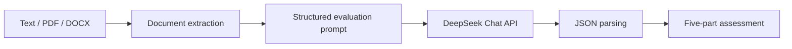

# PM Product Analyzer

**An AI-assisted decision-support tool that helps early-stage product teams challenge assumptions and identify what to validate next.**

[Try the live demo](https://pm-appuct-analyzer-rfzsiadhjcypqvrchhwgvn.streamlit.app)

> This tool generates structured, rubric-based hypotheses. It does not replace primary research, verified market data, or human product judgment.

## Overview

Early-stage product feedback is often unstructured, inconsistent, and overly encouraging. PM Product Analyzer turns a rough product concept—or an uploaded PDF/DOCX document—into a consistent five-part assessment:

- Market opportunity
- Competitive landscape
- User pain points and jobs-to-be-done
- Business model
- Go/No-Go recommendation with a 100-point scoring breakdown

The MVP was built as an individual project for Northeastern University's AI Applications Bootcamp, Track B: Productivity Tool (February–March 2026).

## The Problem

Evaluating a new product concept usually requires teams to examine market potential, competitors, customer pain points, differentiation, monetization, and go-to-market feasibility. At an early stage, however, teams may receive feedback that is subjective, scattered, or uniformly positive.

The product question was:

> Can AI help teams challenge a concept consistently, expose weak assumptions, and clarify what should be validated next?

## Key Product Decisions

| Product decision | Rationale |
| --- | --- |
| Designed against default AI optimism | Early generic prompts produced consistently encouraging responses with weak differentiation. The system prompt was rewritten to challenge assumptions and reserve high scores for unusually strong concepts. |
| Made the reasoning visible | The interface separates the output into five sections so users can inspect the analysis instead of trusting a single black-box score. |
| Scoped out live market research | Real-time search exceeded the MVP build constraint. AI-generated TAM/SAM/SOM estimates are therefore presented as directional hypotheses, not verified evidence. |
| Supported document ingestion | PDF and DOCX extraction lets users evaluate an existing PRD or proposal without re-entering the concept manually. |
| Chose DeepSeek for the reasoning layer | It offered a more practical API cost for an unfunded student project while remaining compatible with the OpenAI Python SDK interface. |

## How It Works



1. The user enters a concept or uploads a PDF/DOCX file.
2. PyPDF2 or python-docx extracts the document text.
3. The app combines the content with a critical product-evaluation rubric.
4. DeepSeek returns a structured JSON response.
5. Streamlit displays the results across five tabs and allows JSON download.

## Evaluation Framework

The Go/No-Go recommendation uses five weighted dimensions:

| Dimension | Weight |
| --- | ---: |
| Product-market fit | 30 |
| Market size and growth | 25 |
| Competitive differentiation | 20 |
| Business model viability | 15 |
| Go-to-market feasibility | 10 |
| **Total** | **100** |

Verdict thresholds:

- **GO:** 75–100
- **CONDITIONAL GO:** 50–74
- **NO-GO:** Below 50

These thresholds are part of the prompt-designed rubric and have not yet been validated as a predictive model of product success.

## Current Outcome

The MVP works end-to-end. A user can submit a product concept through text, PDF, or DOCX and receive:

- TAM, SAM, and SOM hypotheses
- Market trend hypotheses
- Competitor strengths and weaknesses
- Jobs-to-be-done and user frustrations
- A Business Model Canvas
- Dimension-level scores, rationales, and risks
- An overall Go/No-Go recommendation
- A downloadable JSON report

## Limitations

- Market figures and competitor details may be outdated, unsupported, or hallucinated because the app does not retrieve live sources.
- The scoring rubric reflects model behavior and prompt design, not an objectively validated product-success model.
- Uploaded documents are text-extracted; complex tables, charts, and scanned image-only PDFs may not parse correctly.
- The output should support human judgment, not automate investment or product decisions.

## Validation Plan

Before expanding the feature set, the next priority is to validate whether the assessment is actually useful:

1. Test 10–15 deliberately strong, weak, and incomplete concepts.
2. Measure score differentiation, JSON parsing reliability, and failure cases.
3. Ask 3–5 product professionals to assess the same concepts.
4. Compare expert reasoning with the tool's risk identification and recommendations.
5. Observe whether users leave with a clearer next validation step.

## Tech Stack

- Python
- Streamlit
- DeepSeek Chat API
- OpenAI Python SDK
- PyPDF2
- python-docx
- JSON

## Run Locally

### 1. Clone the repository

```bash
git clone https://github.com/Celiaaaaa0912/pm-product-analyzer.git
cd pm-product-analyzer
```

### 2. Install dependencies

```bash
pip install -r requirements.txt
```

### 3. Configure the API key

macOS/Linux:

```bash
export DEEPSEEK_API_KEY="your_api_key"
```

Windows PowerShell:

```powershell
$env:DEEPSEEK_API_KEY="your_api_key"
```

### 4. Start the app

```bash
streamlit run app.py
```

## Repository Structure

```text
pm-product-analyzer/
├── app.py
├── requirements.txt
└── README.md
```

## Roadmap

- Integrate live search with citations for market and competitor claims
- Add clearer source-confidence and missing-evidence indicators
- Compare model scores with expert PM evaluations
- Improve handling of malformed model responses and document parsing errors
- Add PDF export only after validating demand for report sharing

## Project Context

**Role:** Product strategy, UX structure, prompt design, and implementation  
**Team:** Individual project  
**Program:** AI Applications Bootcamp, Northeastern University  
**Track:** Productivity Tool  
**Timeline:** February–March 2026
